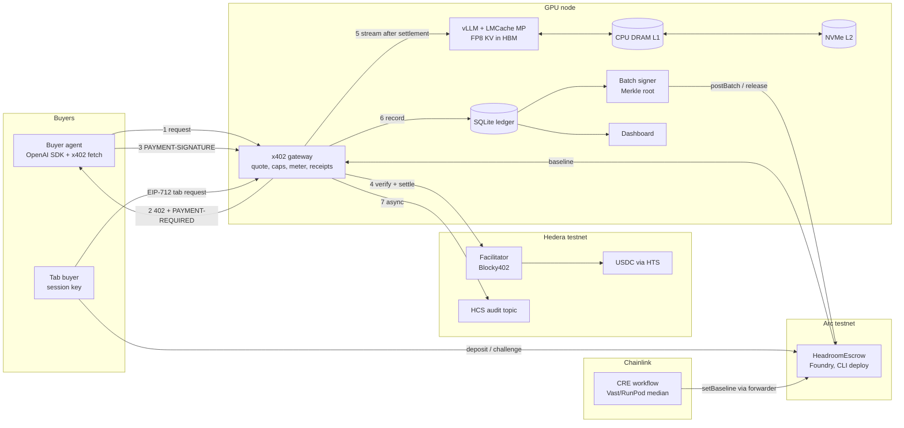

# Headroom

Long-context inference on cheap memory, sold per token to agents.

One GPU node runs vLLM + LMCache so only hot KV cache sits in HBM; warm KV parks in CPU DRAM and cold KV on NVMe. Agents pay per request over x402 on Hedera testnet (USDC via HTS), with every paid request logged to a Hedera Consensus Service topic. A Chainlink CRE workflow sets the H200-equivalent price baseline, and each baseline is also logged on HCS. Long-running agents can instead run a tab that settles in USDC through a savings-share escrow on Arc testnet; Arc is the tab settlement chain and the CRE write target.

Built at ETHGlobal Mumbai, 5 to 7 Nov 2026. Tracks: Hedera x402 (primary), Chainlink CRE.

## Status

- Works live on testnet: x402 paid requests on Hedera (HTS USDC, Blocky402 facilitator), one HCS audit message per paid request, the Arc escrow tab lifecycle including challenge and refund, and the Chainlink CRE price baseline relayed to Arc. Transaction links are in "Settled transactions".
- Measured: Spike A on an RTX 4090, KV reloaded from CPU DRAM and NVMe (282,880 L1 and 40,448 L2 hit tokens; 3 of 3 probes matched over 8 output tokens). Log in "Inference node". The 64-token correctness check (M5) fails; see "Benchmark".
- Pending: the capacity bench (`make bench`), which replaces the bootstrap pricing inputs with `bench/results/latest.json`.

## Demo video

Video: `<link to be added before submission>`

## Architecture



Request flow (Mode A, x402 on Hedera): the buyer sends a chat completion, the gateway tokenizes the prompt and answers `402` with an exact micro-USDC quote, the buyer retries with a signed HTS transfer, and the facilitator verifies and settles it on Hedera. Payment settles before the engine runs: only after settlement does the request reach vLLM, and the `PAYMENT-RESPONSE` header with the Hedera transaction id precedes the first streamed token. The meter then records tokens, cache hits, latency and price, signs an EIP-712 receipt, and posts one message to the HCS audit topic. Mode B (tab on Arc) accrues usage against an escrow deposit; the signer posts a Merkle root per batch, the buyer can challenge any record inside the dispute window, and release pays the operator after the window. Full diagram source: `docs/architecture.md`.

## Inference node

Spike A ran on 2026-11-06 on a rented RTX 4090 24 GB (Vast.ai), config C (FP8 KV, LMCache MP offload to CPU DRAM and NVMe), model `RedHatAI/Meta-Llama-3.1-8B-Instruct-FP8`, image `lmcache/vllm-openai:v0.5.6`, vLLM 0.31.0, LMCache 0.5.6. Three 17k-token prompts were stored, 80 filler prompts evicted them from GPU KV and L1, then all three reloaded from L1/L2 with identical output. Full log: `docs/evidence/2026-11-06/spikeA-4090.txt`.

```
RESULT l1_hits=282880 l2_hits=40448 bit_exact=True -> PASS
{"kv_cache_gib":10.8,"kv_cache_tokens":176928,"vllm_version":"0.31.0","lmcache_version":"0.5.6"}
```

Pinned versions: `infra/VERSIONS.md`. Node bring-up and endpoints: [infra/README.md](infra/README.md).

## Benchmark (1-run sweep, 2026-11-06 17:00–18:00 UTC, RTX 4090 24 GB, same model, seed 1337)

Configs on the same GPU and model (`RedHatAI/Meta-Llama-3.1-8B-Instruct-FP8`): **A** 16-bit KV, no offload; **B** FP8 KV + GPU prefix cache (the tuned baseline); **C** = B + LMCache CPU DRAM (40 GB) and NVMe tiers. Workload: agent sessions with a 4K shared prefix and private context growing 8K→32K over 8 turns, 5–30 s tool gaps. Capacity = largest N with p95 TTFT on cache hits ≤ 1.5 s and zero errors. **This is one run per config, not the median of 3 the PRD bar (M2) asks for; treat the ratios as indicative.** Raw data: `bench/results/20261106-fast-smoke/` (B, C at N = 4..12; `latest.json` points here) and `bench/results/20261106-1609-full-partial/` (A at N = 4..16 from an interrupted full run; its single B row was cut by the restart and is excluded).

| config | capacity N at the bar | p95 TTFT hit at N = 8 | tok/s at N = 8 | KV reuse at N = 8 |
| --- | --- | --- | --- | --- |
| A (16-bit KV) | **< 4** (fails at 4: 5.2 s) | 19.5 s | 6,339 | 0.21 |
| B (FP8 KV) | **6** | 7.4 s | 8,277 | 0.59 |
| C (FP8 KV + DRAM/NVMe) | **8** | 1.19 s | 10,117 | 0.86 |

Per level for B and C (from `report.md`):

| config | N | p95 TTFT hit ms | tok/s | reuse | L1 hit tokens | L2 hit tokens | GPU KV max | pass |
| --- | --- | --- | --- | --- | --- | --- | --- | --- |
| B | 4 | 792 | 5,359 | 0.83 | | | 69% | ✓ |
| B | 6 | 1,298 | 7,716 | 0.81 | | | 65% | ✓ |
| B | 8 | 7,442 | 8,277 | 0.59 | | | 94% | ✗ |
| B | 10 | 13,825 | 9,172 | 0.52 | | | 96% | ✗ |
| B | 12 | 14,586 | 9,368 | 0.39 | | | 99% | ✗ |
| C | 4 | 862 | 5,229 | 0.84 | 1,222,912 | 0 | 49% | ✓ |
| C | 6 | 1,101 | 7,762 | 0.85 | 1,815,552 | 0 | 53% | ✓ |
| C | 8 | 1,195 | 10,117 | 0.86 | 2,287,616 | 0 | 82% | ✓ |
| C | 10 | 1,709 | 12,072 | 0.86 | 2,516,992 | 193,024 | 100% | ✗ (just over 1.5 s) |
| C | 12 | 2,251 | 14,043 | 0.87 | 2,475,008 | 656,128 | 99% | ✗ |

What this shows: once B's GPU KV fills (N ≥ 8) its cache reuse collapses and TTFT jumps to 7–15 s, while C keeps reuse at 0.86 by reloading from DRAM and, from N = 10, NVMe, and serves up to 1.5x B's tokens per second at N = 12 with TTFT 2.3 s vs 14.6 s. Against the bars: **M2 (N_C ÷ N_B ≥ 2.0) fails at 1.33x** (8 vs 6, one run); N_C ÷ N_A ≥ 2x (8 vs < 4); M1 passes (L1 and L2 hits above zero, GPU KV at 99–100%); M6 passes (65,520 measured vs 65,536 bytes per token, 0.02%); M7: the formula predicts N_max ≈ 18 from S_HBM 5.2 and S_DRAM 16.6 sessions at measured duty cycle u = 0.28, against 8 measured, so the hit-latency bar, not memory, is the binding limit on this GPU (PCIe 3.0 host, 12 GB/s).

Correctness (`make correctness`, 20 greedy prompts × 64 tokens, run 2026-11-06 16:04Z, `bench/results/correctness/`): **M5 fails.** Controls: config C on a cold prefill matches config B on a cold prefill on 20 of 20 prompts, and B's own GPU prefix-cache (warm) pass differs from its cold pass on 3 of 20. But C's output after store, evict and reload from LMCache DRAM/NVMe differs from C's own cold output on 15 of 20, some from the first tokens. So the reload path changes results beyond vLLM's normal warm/cold jitter. Spike A's three 8-token probes did match after reload. Under investigation (DRAM-only vs NVMe reload, chunk alignment); we do not claim bit-exact reload.

## Layout

| Dir | What |
| --- | --- |
| `docs/` | PRD, architecture, check log, AI disclosure, evidence |
| `infra/` | pinned vLLM + LMCache image, configs A/B/C, node scripts |
| `bench/` | replay harness, metrics scraper, report, raw results |
| `gateway/` | x402 gateway, pricing, caps, meter, HCS log |
| `signer/` | Merkle batch signer and Arc reconcile |
| `contracts/` | `HeadroomEscrow` (Foundry: `src/`, `test/`, `make escrow-test`), interface, spec, ABI |
| `cre/` | Chainlink CRE price-baseline workflow |
| `agent/` | demo buyer agent |
| `dashboard/` | public dashboard |
| `scripts/` | top-up, depth check |

## Setup

Prerequisites: Node 22 and pnpm; Foundry (contracts); Bun and the `cre` CLI (CRE workflow); Python 3.12 with `httpx`, or `uv` (bench harness).

1. `cp .env.example .env` and fill it. Secrets never go in the repo. The gateway refuses to boot until `GPU_USD_PER_HR`, `BOOTSTRAP_TOKENS_PER_HR_B` and `BOOTSTRAP_TOKENS_PER_HR_C` are set; they stand in for the bench until `bench/results/latest.json` exists.
2. Gateway, signer, agent, dashboard: `pnpm install` in each directory. The gateway, signer and agent read the repo-root `.env`. The dashboard runs from `dashboard/` and resolves `LEDGER_PATH` against the repo root, so the default `./gateway/ledger.db` works; if you set it in `dashboard/.env.local`, keep that form or use an absolute path.
3. Contracts: `cd contracts && forge test` (Foundry, solc 0.8.28, offline build).
4. CRE workflow: `cd cre/price-baseline && bun install`, then `cre login`, then `cre workflow simulate price-baseline --target staging-settings`.
5. Bench: `make bench-smoke` or `make bench` on the GPU node; the harness defaults to `uv run --with httpx python3`.
6. GPU node: [infra/README.md](infra/README.md).

## Make targets

`bench`, `bench-smoke`, `correctness`, `audit-prices`, `caps-test`, `replay-test`, `reconcile`, `demo`, `settle-demo`. Run `make help`.

## Payment flow (x402 v2 on Hedera, Mode A)

1. `POST /v1/chat/completions` with no payment: the gateway tokenizes the prompt (vLLM `/tokenize`, CPU only), checks the buyer's caps, and returns `402` with a `PAYMENT-REQUIRED` header: `scheme exact`, `network hedera:testnet`, `asset 0.0.429274` (USDC via HTS), `amount` = the exact micro-USDC quote, `payTo` = operator account, `extra.feePayer` = facilitator, `extra.paymentFlow = upfront`, 60 s timeout.
2. The agent's x402 client builds a partially signed HTS transfer and retries with `PAYMENT-SIGNATURE`.
3. The gateway rejects replays, then the facilitator verifies and settles the transfer on Hedera. Only after settlement does the request reach vLLM; `PAYMENT-RESPONSE` (with the Hedera transaction id) is sent before the first token.
4. The meter records tokens, cached tokens, tier hits, latency and price; an EIP-712 receipt is signed; one message goes to the HCS audit topic.

Quote formula, published at `/pricing`: `q = ceil((r_in × prompt_tokens + r_out × max_tokens) / 1e6)` micro-USDC. `make audit-prices` recomputes it from the ledger.

Spend controls: `PUT /v1/budget` (daily cap, per-request max, model allowlist), `X-Headroom-Max-Price` header. Over-cap requests are refused before any quote. `make caps-test` proves the vLLM counter does not move.

Tab mode (Arc): deposit USDC into the escrow, register a session key, send requests with `X-Headroom-Tab` (EIP-712). The signer posts a Merkle root per batch; any record can be challenged with a proof and the signed receipt; `make settle-demo` runs the whole lifecycle, `make reconcile` checks the accounting identity.

## Settled transactions

Every entry below is a real testnet transaction. The CRE simulation log is in `docs/evidence/2026-11-06/`.

**Hedera x402 (Spike B, 2026-11-06).** Real x402 v2 `exact` payments in HTS USDC (`0.0.429274`) from the demo agent `0.0.11334561` to the operator `0.0.11334469`, verified and settled by the Blocky402 testnet facilitator (fee payer `0.0.7162784`), with `paymentFlow: upfront`. In this spike inference came from a local fake vLLM (no GPU yet); the payment path has no mocks. Replaying a used payment returns `402 payment_replayed`.

- https://hashscan.io/testnet/transaction/0.0.7162784@1793945676.464874990 (first settlement: 5 micro-USDC agent to operator)
- https://hashscan.io/testnet/transaction/0.0.7162784@1793945730.865773365
- https://hashscan.io/testnet/transaction/0.0.7162784@1793945757.475561626
- https://hashscan.io/testnet/transaction/0.0.7162784@1793945812.185413823
- https://hashscan.io/testnet/transaction/0.0.7162784@1793945878.139851347
- https://hashscan.io/testnet/transaction/0.0.7162784@1793946015.228065975

**HCS audit topics.** Spike: https://hashscan.io/testnet/topic/0.0.11335247 (7 spike records, 7 messages). Production ledger: https://hashscan.io/testnet/topic/0.0.11336690, one message per paid request. On 2026-11-06 the topic holds 71 messages: 70 from `gateway/ledger.db` (50 Hedera x402 requests + 20 tab requests) plus 1 from a `make replay-test` run against the spike ledger at 14:32 IST (request `00c1d592…`, tx `0.0.7162784@1793955754.238234855`).

**Demo agent, 50 unattended paid requests (P2, P3; 2026-11-06 14:17 IST).** `agent/src/agent.ts` ran 20 turns (exit 0), then 30 more before the gateway's context cap refused turns 31 to 35 with `400 context_too_long`. Every turn paid in HTS USDC through Blocky402; inference was the local fake vLLM (no GPU yet). `make audit-prices`: `sampled=50 mismatches=0`. Logs with all 50 transaction ids: `docs/evidence/2026-11-06/demo-*.jsonl`. First and last: https://hashscan.io/testnet/transaction/0.0.7162784@1793954816.086040213, https://hashscan.io/testnet/transaction/0.0.7162784@1793955006.870343589

**Price baseline (D1), Chainlink CRE.** Latest run 2026-11-06 21:00 IST: `cre-sim:d30963846d8af2f9`, H100 $3.4053/h (5 offers), H200 $4.3066/h (20 offers), relayed to Arc (https://explorer.testnet.arc.io/tx/0x0711b224103936d0d304a5deeb709173d65be8ab191f722edca52a03102c7b1a, https://explorer.testnet.arc.io/tx/0xbe91d44b634952b4184e737f3a3f5f7b0e333677e623f864d2acd34dd4d6d003), HCS baseline topic messages 3 and 4, log `docs/evidence/2026-11-06/cre-sim-1793978988.txt`; re-run with `make fresh-baseline` (see `docs/evidence/2026-11-06/fresh-baseline-howto.md`), the baseline is flagged stale after 1 h. Previous run 19:08: `cre-sim:ca88c9703a4b6e88`, H100 $3.4053/h, H200 $4.0022/h, relayed to Arc (https://explorer.testnet.arc.io/tx/0xaf2997edc96506783d8df256f4aad7a7589892bc8d2f3b187d68f3bc1acdb32b, https://explorer.testnet.arc.io/tx/0x0ccb5be92e19750fb4a4ff4592d508f10ebb23751ad2c762657bd214928c0501) and logged on the HCS baseline topic https://hashscan.io/testnet/topic/0.0.11339845 (messages 1 and 2). First run: `cre workflow simulate price-baseline --target staging-settings` (2026-11-06 17:44 IST): cron trigger, Vast.ai fetch on every node, consensus median H100 $3.4053/h (8 offers), H200 $3.9956/h (18 offers), dry-run `writeReport` to the escrow. The simulator uses a MockForwarder, so the operator relayed the consensus values with `setBaseline`, labelled `cre_run_id = cre-sim:22926f0036f6f2c9` (log: `docs/evidence/2026-11-06/cre-sim-1793967257.txt`): https://explorer.testnet.arc.io/tx/0xea1ba3edb1397309b071461590165aafe14de83f48cf90cc451373c612891b7c, https://explorer.testnet.arc.io/tx/0x93f325877e41fadb302f12941b2967943382ea79c515502fac16d8e7380ce784. An earlier manual relay of the same Vast.ai query (14:22 IST): https://explorer.testnet.arc.io/tx/0x91ecefa098134ed6add2d025cae75b6ead93012b9da88dd39d135c185a5638d3

**Arc escrow and tab lifecycle (S1–S5; 2026-11-06 14:21–14:32 IST).** `contracts/src/HeadroomEscrow.sol` implements `contracts/IHeadroomEscrow.sol`, passes 12 Foundry tests (`make escrow-test`) and was deployed to Arc testnet from the CLI (`signer/src/deploy-escrow.ts`); the Arc judges confirmed a CLI deploy qualifies, Arc Studio is not required. `make settle-demo` output: `docs/evidence/2026-11-06/settle-demo-1793955725459.json`.

- Deploy: https://explorer.testnet.arc.io/tx/0x71180ce68fe6cfb70a78098bdfbb82add98dfa9741ad0fbedb93902ef57e54f0 (escrow `0xfa7b11252defd7ce61d271f2cbfc8eab7a5acb6f`)
- Verified source on the explorer: https://explorer.testnet.arc.io/address/0xfa7b11252defd7ce61d271f2cbfc8eab7a5acb6f?tab=contract (Blockscout partial match: bytecode identical, metadata hash differs because the header comment and file path changed after deploy)
- Bond: https://explorer.testnet.arc.io/tx/0x9bbd587ad57cf49071f996e24f3c9f318cf2c2b4f89664360922a0fb60b653b4
- Deposit 2 USDC: https://explorer.testnet.arc.io/tx/0x618b126848cf44905c8ee8b5e25db943c3acb51c366cfc46bd6a8854a9f5fad0
- Session key: https://explorer.testnet.arc.io/tx/0xf729ad5a1eac33ee5ed6cbe92d6b28c4dc8198d860e9be13c873422ef2d0d348
- Wrong batch posted (one leaf overpriced): https://explorer.testnet.arc.io/tx/0xb4cb88105f9ec585a538fdf44bae607dbc986ea524e6591f0664afb5a7b9854a
- Clean batch posted: https://explorer.testnet.arc.io/tx/0xea7f6cac5b54510da1ec768cb11a662a32742d89e00ef515c7f710dcc032f683
- Challenged and refunded (Merkle proof + signed receipt, 155 refunded + 0.10 USDC penalty): https://explorer.testnet.arc.io/tx/0x47f61d189681b5fe547b728193c4890c2d15fdb68121736adeab3edffe6cd271
- Released after the 600 s window: https://explorer.testnet.arc.io/tx/0x8ffe44187871da8591b9f2c5bb1d5a9c496160356475dd400e12698c5fdef097
- `make reconcile`: PASS, `2100000 == 2100000` (`docs/evidence/2026-11-06/reconcile-1793955730860.json`)
- S5 on chain: `postBatch(amount=10, baselineAmount=9)` reverts with `AboveBaseline()` (`0xc88db978`)


**Arc testnet funding.** Operator `0x3F3A94169113A84fd54D257c018c62cFBc30D0EB` and demo buyer `0xBfa851839FDE3F1A21de800b196139337c519625`, 20 USDC each from faucet.circle.com.

## Known limitations

- Per-buyer cache salting and NVMe encryption from the PRD are not in this build; KV on L1/L2 is shared and unencrypted.
- The 60 s quote expiry is set in `PAYMENT-REQUIRED` but the facilitator does not enforce it.
- If the engine fails after settlement, the request is charged and marked failed in the ledger; there is no credit-back (PRD F12 not built).
- The price baseline goes stale after 1 h without a new CRE run; `/pricing` flags it but keeps serving the last value.
- No external payers yet: every settled transaction above came from the project's own demo agent and tab buyer.
- Inference behind the Hedera and Arc evidence was a local fake vLLM; the real engine was validated separately in Spike A and is not yet wired end to end with paid requests.

## AI use

See `docs/ai-disclosure.md`.
