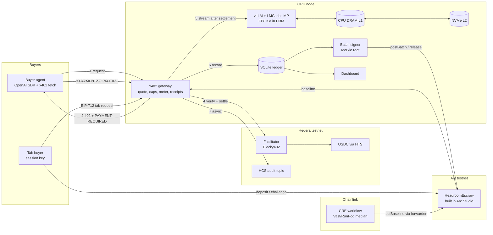

# Architecture

One GPU node runs everything Headroom owns. Hedera, Arc and Chainlink are the only outside dependencies.

Request flow (Mode A): payment settles on Hedera before the engine starts; `PAYMENT-RESPONSE` precedes the first token. Mode B: usage accrues on a tab, the signer posts a Merkle root every N requests or T minutes, the buyer can challenge any record inside the dispute window with a proof and the operator-signed receipt, and release pays the operator after the window.
